<p align="center">
  
</p>

<p align="center">
  <a href="https://www.anypayx.com"></a>
  <a href="https://www.npmjs.com/package/@anypay/simple-wallet"></a>
  <a href="https://www.npmjs.com/package/@anypay/simple-wallet"></a>
  
</p>

<p align="center">
  <a href="https://www.anypayx.com">Website</a> ·
  <a href="https://www.anypayx.com/docs">Docs</a> ·
  <a href="https://api.anypayx.com/api">API</a> ·
  <a href="https://www.anypayx.com/walletbot">WalletBot</a> ·
  <a href="https://github.com/anypay/simple-wallet">GitHub</a> ·
  <a href="https://www.npmjs.com/package/@anypay/simple-wallet">npm</a>
</p>

---

## What It Is & Purpose

**Anypay Simple Wallet** is a TypeScript/JavaScript multi-coin wallet library and CLI for building applications that control cryptocurrency and testing Anypay payments in production. It implements the **JSON Payment Protocol V2** specification, making it compatible with Anypay and Bitpay payment systems.

Simple Wallet provides a unified interface for managing multiple cryptocurrency wallets from a single codebase. Load private keys or BIP39 mnemonic seeds, check balances across chains, build and sign transactions, and pay invoices—all through a consistent API whether you're working with Bitcoin, Litecoin, Dash, or other supported coins.

The library powers rapid prototyping and testing workflows for developers building on Anypay, abstracting away the complexity of multi-chain key management, UTXO handling, transaction construction, and payment protocol negotiation.

## Why Use It

- **Multi-Chain from Day One:** Support for Bitcoin (BTC), Bitcoin Cash (BCH), Bitcoin SV (BSV), Litecoin (LTC), Dogecoin (DOGE), Dash (DASH), and XRP—with consistent APIs across all chains.
- **Payment Protocol Native:** Built-in JSON Payment Protocol V2 client that speaks to Anypay and Bitpay servers, with automatic chain selection, payment request handling, and broadcast.
- **Developer Testing Tool:** Quickly pay test invoices, check balances, and verify payment flows without complex wallet setup—ideal for testing Anypay integrations.
- **Library & CLI:** Use it programmatically in Node.js apps or directly from the command line with the `simplewallet` binary.
- **BIP39 Mnemonic Support:** Generate wallets from seed phrases or load from individual private keys via environment variables.

**Who it's for:** Anypay integrators, payment app developers, QA engineers testing multi-coin payment flows, and anyone prototyping cryptocurrency payment features.

**Where it fits:** Simple Wallet sits between your application code and the Anypay invoice API. It handles wallet state, transaction signing, and payment protocol negotiation so you can focus on your product's payment experience.

## How It Works

<p align="center">
  
</p>

1. **Seed/Keys:** Load a wallet from BIP39 mnemonic seeds (supporting multiple coins from one seed) or individual WIF private keys set in environment variables.
2. **Multi-Coin Balance:** Query balances across all supported chains with a single `balances()` call. Simple Wallet uses public blockchain explorers (Blockchair, Mempool.space) and RPC interfaces to fetch UTXO sets and account states.
3. **Sign & Broadcast:** When paying an Anypay invoice, the library selects the matching payment option, builds the transaction with proper outputs and fees, signs it with the loaded private key, and transmits it via the Payment Protocol.
4. **Invoice Paid:** The signed payment transaction is delivered to Anypay, which verifies and broadcasts it. The invoice is marked paid, completing the payment flow.

Simple Wallet also supports a `TestClient` for integration testing against local Hapi or Supertest-compatible servers, letting you verify payment protocol implementations without hitting live endpoints.

## Quickstart / How to Use It

### Installation

```bash
npm install @anypay/simple-wallet
```

### Environment Variables

Configure private keys for the coins you want to use:

```bash
export BTC_PRIVATE_KEY="your_btc_wif"
export BCH_PRIVATE_KEY="your_bch_wif"
export BSV_PRIVATE_KEY="your_bsv_wif"
export LTC_PRIVATE_KEY="your_ltc_wif"
export DOGE_PRIVATE_KEY="your_doge_wif"
export DASH_PRIVATE_KEY="your_dash_wif"
export XRP_PRIVATE_KEY="your_xrp_private_key"
```

### CLI Usage

Simple Wallet ships with a `simplewallet` CLI:

```bash
# Check balances across all configured coins
simplewallet balances

# Check balance for a specific asset
simplewallet balance BTC

# Pay an Anypay invoice by UID
simplewallet pay <invoice_uid> <asset>

# Build a payment without broadcasting (for testing)
simplewallet buildpayment <invoice_uid> <asset>

# Pay from a Payment Protocol URI
simplewallet payuri <payment_uri> <asset>

# Get payment options from a payment request URI
simplewallet paymentrequest <uri> <currency>
```

### Programmatic Usage

#### Load a Wallet and Check Balances

```typescript
import { Wallet } from '@anypay/simple-wallet'

const wallet = await Wallet.load([
  { asset: 'BTC', privatekey: process.env.BTC_PRIVATE_KEY },
  { asset: 'LTC', privatekey: process.env.LTC_PRIVATE_KEY }
])

const balances = await wallet.balances()
console.log(balances)
// [{ asset: 'BTC', value: 50000, value_usd: 25.00, address: '1ABC...' }, ...]
```

#### Pay an Anypay Invoice

```typescript
import { Wallet } from '@anypay/simple-wallet'

const wallet = await Wallet.load([
  { asset: 'BSV', privatekey: process.env.BSV_PRIVATE_KEY }
])

const payment = await wallet.payInvoice('3kbn9ids', 'BSV')
console.log(payment)
// { tx_hex: '0100000001...', tx_hash: 'abc123...' }
```

#### Use the Payment Protocol Client Directly

```typescript
import { Client, Wallet } from '@anypay/simple-wallet'

const client = new Client('https://anypayx.com/i/3kbn9ids')

const { paymentOptions } = await client.getPaymentOptions()
const bsvOption = paymentOptions.find(opt => opt.currency === 'BSV')
const paymentRequest = await client.selectPaymentOption(bsvOption)

const wallet = await Wallet.load([
  { asset: 'BSV', privatekey: process.env.BSV_PRIVATE_KEY }
])

const payment = await client.sendPayment(wallet, paymentRequest)
console.log(payment)
```

#### Test Against a Local Server

```typescript
import { TestClient } from '@anypay/simple-wallet'
import supertest from 'supertest'
import { app } from '../server'

const server = supertest(app)
const client = new TestClient(server, '/i/3kbn9ids')

const { paymentOptions } = await client.getPaymentOptions()
// Your local server responds as if it were Anypay
```

### Build from Source

```bash
git clone https://github.com/anypay/simple-wallet.git
cd simple-wallet
npm install
npm run build
npm test
```

## Next Moves for Growth

1. **TypeScript Definitions:** The package sets `"main": "src/index.ts"` but ships no compiled JavaScript or `.d.ts` files. Publish a built `dist/` folder with type declarations so consumers don't need `ts-node` to use the library.

2. **Test Coverage:** The repository includes Jest configuration (`"test": "jest"`) but no test files exist in the codebase. Add unit tests for wallet loading, balance queries, transaction building, and payment protocol flows to prevent regressions.

3. **Monero Support:** XMR code exists in `src/assets/xmr/` and `src/bin/monero.ts`, but Monero wallet functionality is commented out in `loadWallet()`. Complete the Monero integration or document its experimental status.

4. **Fee Estimation:** Bitcoin uses `mempool.space` for dynamic fee recommendations, but other coins fall back to bitcore defaults. Implement dynamic fee estimation for LTC, DASH, BCH, and BSV to avoid overpaying or stuck transactions.

5. **Documentation Site:** The library has rich functionality but no dedicated documentation beyond this README. Host API docs (TypeDoc or similar) showing every method, parameter, and return type for each class (Wallet, Card, Client, TestClient).

6. **Error Recovery:** `balances()` silently filters out null results when Blockchair or RPC calls fail. Surface these errors clearly so developers can distinguish between "zero balance" and "could not reach chain."

7. **Semantic Versioning & CI:** The package is at `0.6.6` with a `semantic-release` devDependency but no visible CI configuration. Wire GitHub Actions to run tests and auto-publish to npm on merge to `master`, ensuring consistent releases.

## Anypay Ecosystem & License

**Anypay Simple Wallet** is part of [Anypay](https://www.anypayx.com) — Bitcoin & Stablecoin payments for business. Merchants and developers use Anypay to accept BTC, ETH, and stablecoins such as USDC, USDT, RLUSD, and NUSD through invoices, APIs, SDKs, webhooks, WooCommerce, and mobile POS.

| Project | Role |
| --- | --- |
| [anypay](https://github.com/anypay/anypay) | Invoice & payments platform / API (`@anypay/server`) |
| [anypay-sdk](https://github.com/anypay/anypay-sdk) | TypeScript SDK for browser & Node.js (`@anypay/client`) |
| [web3-checkout-vite](https://github.com/anypay/web3-checkout-vite) | Current checkout UI (`checkout.anypayx.com`) |
| [walletbot](https://github.com/anypay/walletbot) | Self-custody headless wallet (`@anypay/walletbot`) |
| [anypayx.com](https://github.com/anypay/anypayx.com) | Marketing site, merchant dashboard, and developer docs |

Simple Wallet is especially useful alongside **WalletBot** for automated invoice payment and testing scenarios.

**License:** ISC (as declared in `package.json`). No `LICENSE` file is currently present in the repository—contributors may wish to add the full ISC license text for clarity.

---

<p align="center">
  <a href="https://www.anypayx.com"></a><br/>
  <sub>Bitcoin & Stablecoin Payments For Business · <a href="https://www.anypayx.com">anypayx.com</a> · <a href="https://x.com/xanypay">@xanypay</a></sub>
</p>
